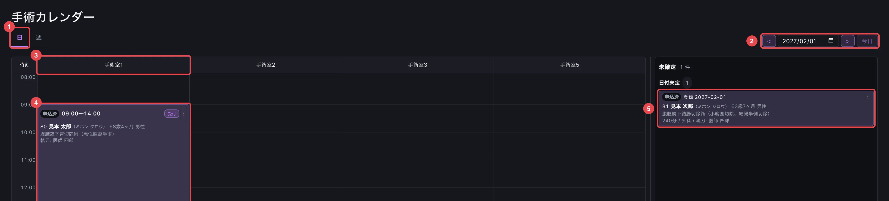
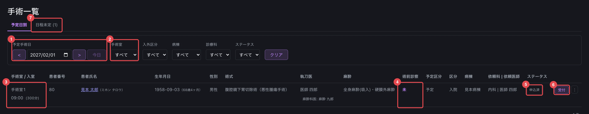
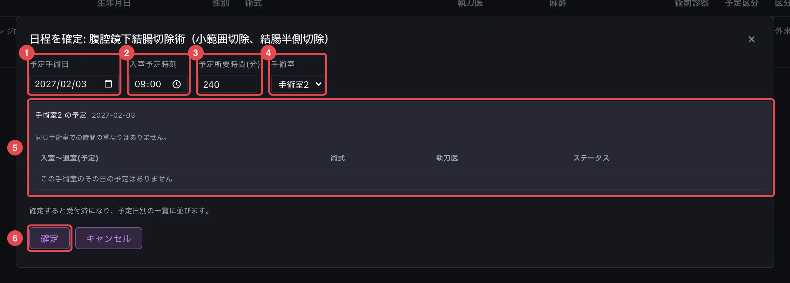
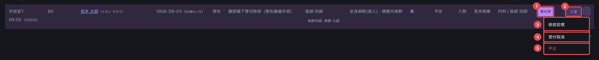
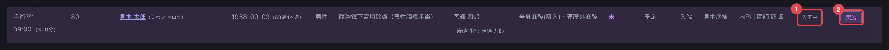
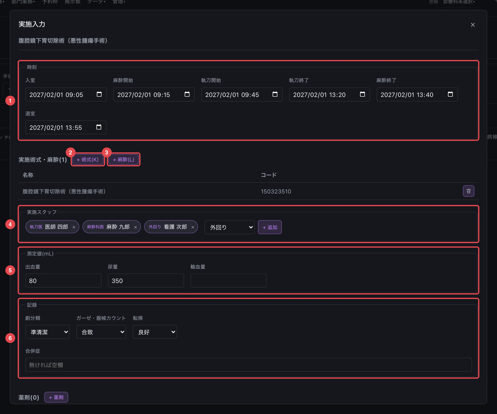
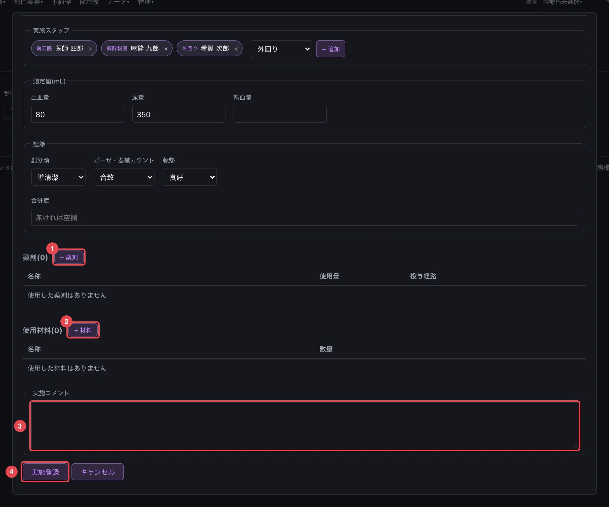
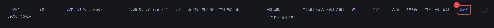

# 手術(一覧・カレンダー)

手術部が、医師の手術申込を手術カレンダーと手術一覧で受けて日程を組み、手術室スタッフが入室と実施を記録する操作です。
手術の流れ全体は、業務フローの[手術オーダー](../flows/surgery.md)を見てください。申込は[手術](surgery.md)のページです。

- 手術一覧は「部門業務」>「手術部門」>「手術一覧」、手術カレンダーは同じく「手術カレンダー」で開きます。
- 手術は「申込済」→(受付・日程確定)→「受付済」→(入室)→「入室中」→(実施入力)→「実施済」と進みます。
- 手術一覧は、その日の手術を 1 件ずつ進める画面です。手術カレンダーは、手術室の空きを見て日程を組む画面です。
- 予約枠は使いません。手術室の空きは、申込の予定日時と所要時間から見ます。
- 麻酔科の術前診察と麻酔チャートは[麻酔チャート・術前診察](anesthesia.md)のページで説明します。

## 手術カレンダーで日程を見る

{ .screen }

1. 「日」は手術室 × 時刻の格子、「週」は曜日 × 手術室の表で見ます。
2. 日付を選びます。「<」「>」で前後へ動かし、「今日」で今日に戻ります。
3. 手術室ごとの列に、その日の手術が並びます。
4. 手術のカードに、状態・予定時刻・患者・術式・執刀医が出ます。申込済のカードには「受付」が出ます。
5. 右の「未確定」に、日付・手術室・時刻の決まっていない申込が並びます。

- カードを掴んで動かすと、日・手術室・時刻を移せます(5 分刻み)。カードの縁を引くと、所要時間を変えられます。動かす前と後、重なり、科の割当が確認に出ます。
- 未確定の申込は、格子へ掴んで落とすと日程が入ります。
- 格子で日程を決めても、申込済のままです。受付は手術一覧かカードの「受付」で行います。
- 日程を外して未確定に戻せるのは、申込済のときだけです。受付済なら、先に「受付取消」をします。

## 手術一覧の見方

{ .screen }

1. 「予定手術日」で日を選びます。
2. 「手術室」「入外区分」「病棟」「診療科」「ステータス」で絞り込めます。
3. 手術室と予定の入室時刻・所要時間の順に並びます。
4. 「術前診察」に、麻酔科の術前診察の状態が出ます。まだなら「未」です。
5. 「ステータス」に作業の状態が出ます。
6. 予定手術日の入った申込は「受付」で受け付けます。
7. 予定手術日の無い申込は「日程未定」のタブに並びます。タブ名に件数が出ます。

## 日程未定の申込の日程を確定する

「日程未定」のタブで、行の「日程確定」を押します。

{ .screen width="1210" }

1. 「予定手術日」を入れます。
2. 「入室予定時刻」を入れます。
3. 「予定所要時間(分)」は、申込の値が入っています。
4. 「手術室」を選びます。
5. その日・その手術室の予定と、科の割当が出ます。同じ手術室で時間が重なる手術があると、ここに出ます。
6. 「確定」を押すと、受付済になって「予定日別」のタブに移ります。

重なる手術があっても確定は止まりません。確認の画面で、承知のうえで確定します。

## 受け付けて入室する

{ .screen }

1. 「受付」を押すと、ステータスが「受付済」になります。
2. 患者が手術室に入ったら「入室」を押します。
3. 行の「⋮」の「術前診察」で、麻酔科の術前診察を書けます。
4. 押し間違えたときは「受付取消」で申込済に戻します。
5. 手術をやめるときは「中止」を押します。

{ .screen }

1. ステータスが「入室中」になります。
2. 退室したら「実施」を押して、実施入力を開きます。

- 緊急・準緊急の申込は、日程未定のまま「日程未定」のタブの「入室」で入室できます。押した日時が予定日時になります。
- 入室は状態を進めるだけです。実施の記録は、退室後にまとめて入れます。

## 実施を記録する

実施入力には、申込の術式・スタッフと、予定の入室時刻が入っています。

{ .screen width="1210" }

1. 「時刻」に、入室・麻酔開始・執刀開始・執刀終了・麻酔終了・退室を入れます。入室と退室は必須で、ほかの時刻は入室から退室までの順に並べます。
2. 申込と違う術式を行ったときは「+ 術式(K)」で足し、行わなかった術式は行のゴミ箱のボタンで外します。
3. 麻酔の算定は「+ 麻酔(L)」で足します。
4. 「実施スタッフ」に、役割を選んで「+ 追加」で器械出し・外回りなどを足します。執刀医は必須です。
5. 「測定値(mL)」に、出血量・尿量・輸血量を入れます。
6. 「記録」に、創分類・ガーゼ・器械カウント・転帰・合併症を入れます。

{ .screen width="1210" }

1. 使った薬剤は「+ 薬剤」で足します。ロット番号を記録する薬は、ロット番号の欄が出ます。
2. 使った材料は「+ 材料」で足します。
3. カウントが合わなかったときは、経緯を「実施コメント」に書きます。
4. 「実施登録」を押します。

{ .screen }

1. ステータスが「実施済」になります。

- 実施の記録を直すときは、行の「⋮」の「実施取消」で実施記録ごと消してから、もう一度実施入力をします。
- 麻酔チャートに入れた薬剤は算定されません。算定する薬剤は、実施入力に入れます。
- 手術記録・麻酔記録は、カルテのテンプレートで書きます。
