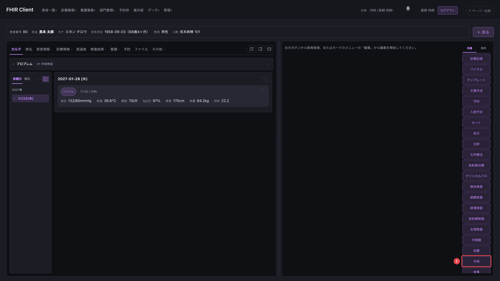
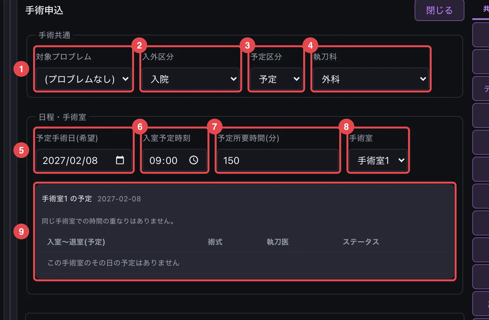
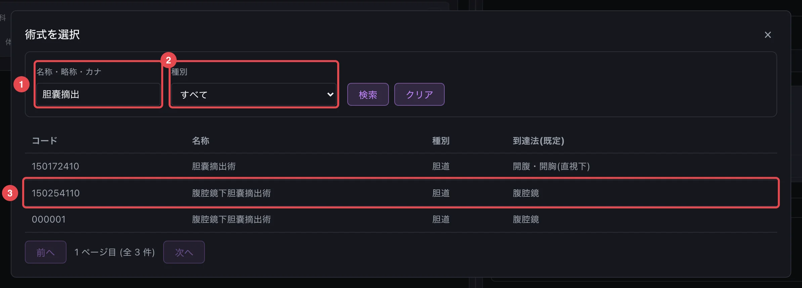
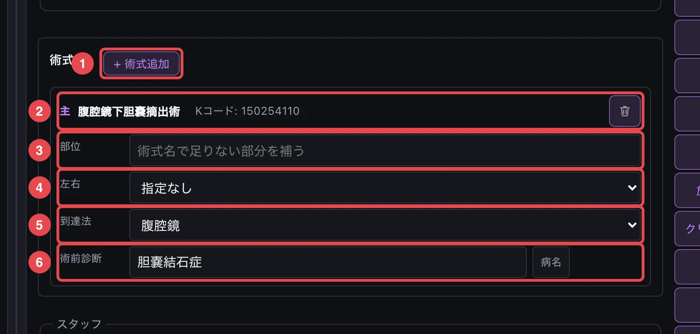
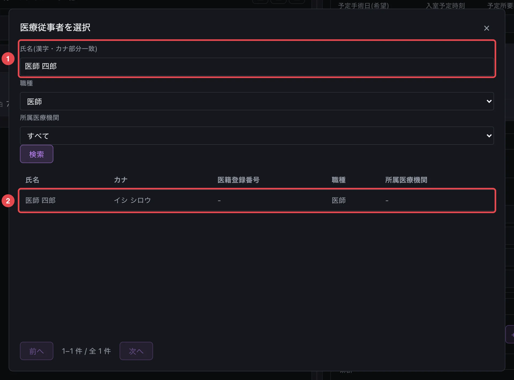
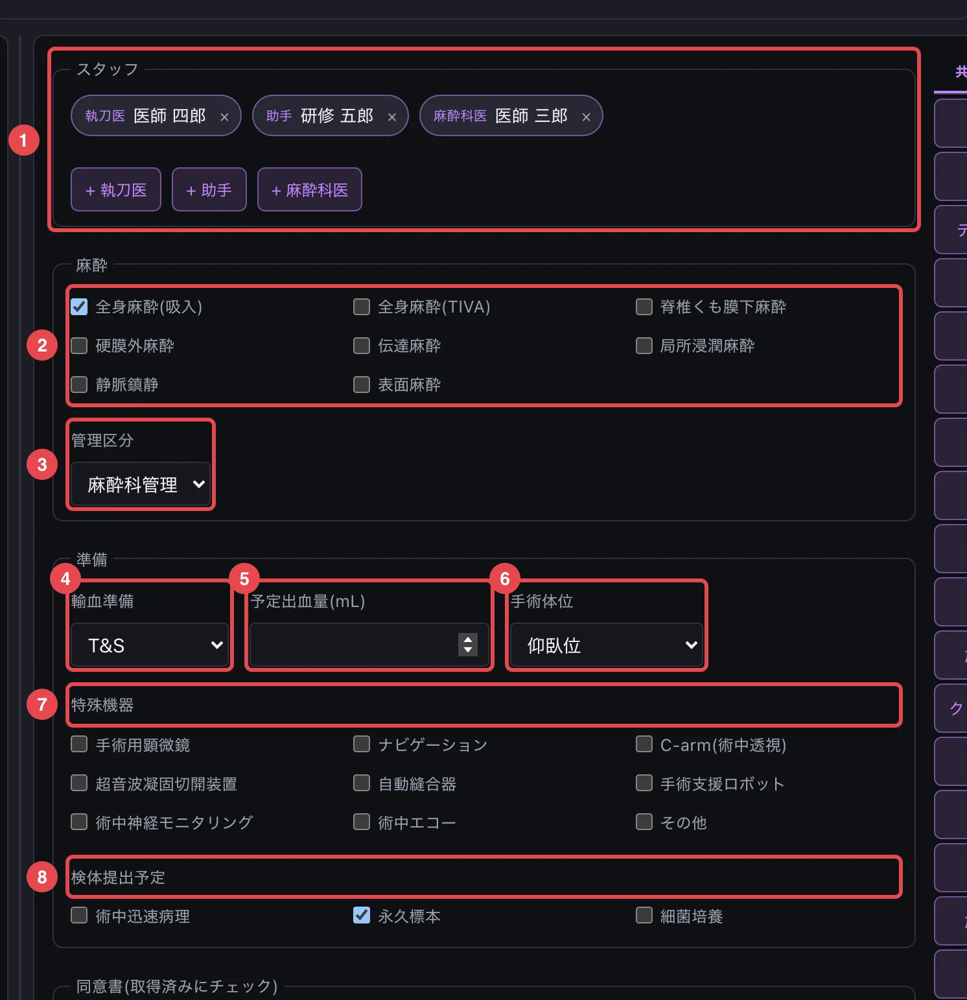
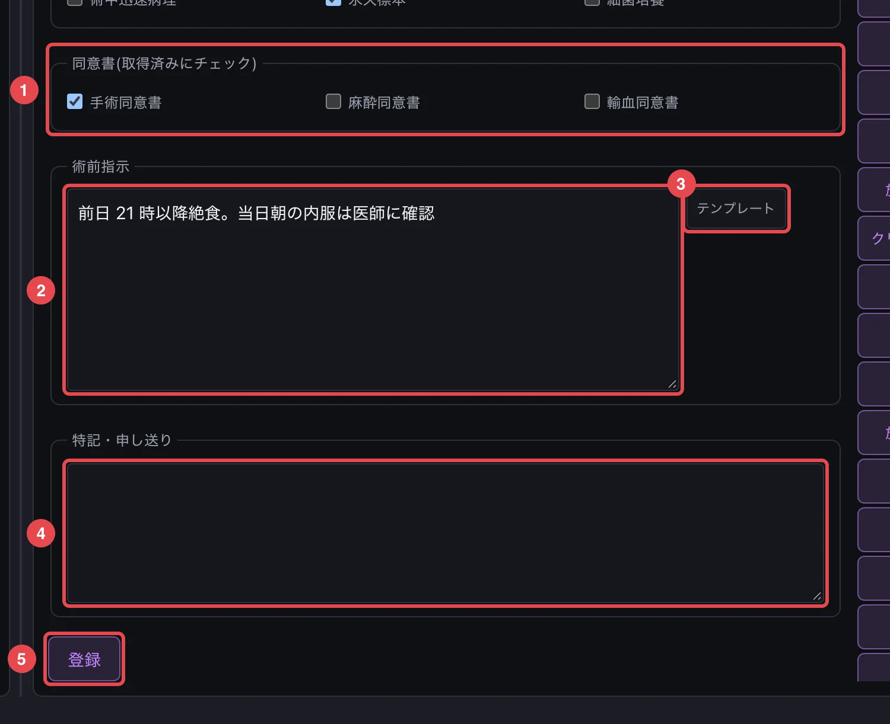
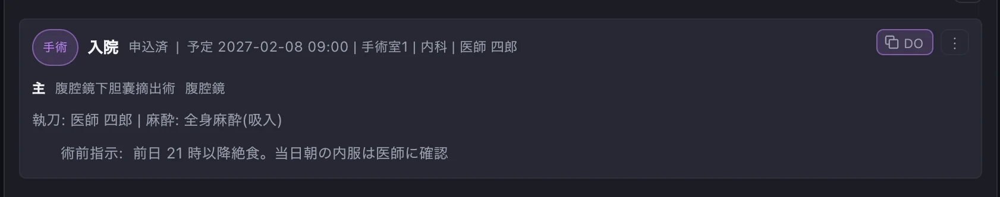
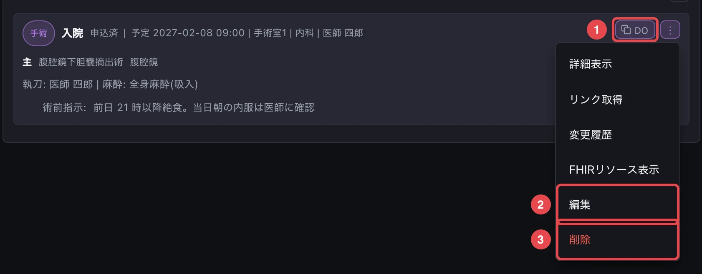

# 手術

医師がカルテから手術を申し込む操作です。申し込んだ手術は、手術部が手術カレンダーで日程と手術室を確定します。
日程の確定・麻酔科術前診察・入室から実施までの流れは、業務フローの[手術オーダー](../flows/surgery.md)を見てください。

## 手術申込を開く

患者のカルテを開いておきます。

{ .screen }

1. カルテの右側に並ぶボタンから「手術」を押します。右側に「手術申込」が開きます。

## 手術共通と日程を入れる

{ .screen width="746" }

1. 「対象プロブレム」で、この手術の対象の病名を選びます。
2. 「入外区分」で「入院」か「外来」を選びます。
3. 「予定区分」を「予定」「準緊急」「緊急」から選びます。
4. 「執刀科」を選びます。
5. 「予定手術日(希望)」に、希望の手術日を入れます。日程は手術部が確定します。
6. 「入室予定時刻」を入れます。時刻を入れるときは、手術日も入れます。
7. 「予定所要時間(分)」を入れます。
8. 希望の手術室があれば「手術室」で選びます。決めないときは「未定」のままにします。
9. 手術日を入れると、その日の手術室の予定が出ます。手術室を選ぶと、その手術室の予定と、時間の重なりがあるかが出ます。

## 術式を選ぶ

「+ 術式追加」を押すと、「術式を選択」が開きます。

{ .screen width="1194" }

1. 「名称・略称・カナ」に術式の名前の一部を入れます。
2. 必要なら「種別」(臓器・部位の区分)で絞り込みます。
3. 「検索」を押し、使う術式の行を押します。

{ .screen width="750" }

1. 術式を足すときは、もう一度「+ 術式追加」を押します。
2. 選んだ術式が出ます。最初の術式が主術式(「主」)で、2 つ目からは副術式です。矢印で順番を入れ替え、ゴミ箱で外します。
3. 術式名で足りない部位があれば「部位」に入れます。
4. 「左右」を選びます。左右のある術式では、取り違えを防ぐため必ず選びます(項目名に「(必須)」と出ます)。
5. 「到達法」を確かめます。術式の到達法が初期値で入っています。
6. 「術前診断」を入れます。「病名」を押すと、患者に登録された病名から選べます。

## スタッフ・麻酔・準備を入れる

スタッフの「+ 執刀医」「+ 助手」「+ 麻酔科医」を押すと、「医療従事者を選択」が開きます。

{ .screen width="954" }

1. 「氏名(漢字・カナ部分一致)」に名前の一部を入れ、「検索」を押します。
2. 選ぶ人の行を押します。

{ .screen width="746" }

1. 「スタッフ」に、選んだ人が役割つきで並びます。「×」で外します。執刀医は必ず選びます。
2. 「麻酔」で、予定の麻酔方法にチェックを付けます。いくつでも選べます。
3. 「管理区分」で「麻酔科管理」か「執刀医管理」を選びます。麻酔科管理のときは、麻酔科医を必ず選びます。
4. 「輸血準備」を選びます。
5. 「予定出血量(mL)」を入れます。
6. 「手術体位」を選びます。
7. 使う「特殊機器」にチェックを付けます。
8. 「検体提出予定」で、術中迅速病理・永久標本・細菌培養の予定にチェックを付けます。

## 同意書・術前指示を入れて登録する

{ .screen width="750" }

1. 取得済みの同意書にチェックを付けます。
2. 「術前指示」に、絶食や内服などの指示を入れます。
3. 「テンプレート」を押すと、施設で用意したテンプレートで術前指示を記入できます。
4. 申し送ることがあれば「特記・申し送り」に入れます。
5. 「登録」を押します。

同じ手術室で時間が重なる手術があるときや、手術室が科に割り当てられた時間に掛かるときは、確認の画面が出ます。
重なる手術が並ぶので、確かめて登録します。重なりがあっても登録はできます。

登録すると右側が閉じ、カルテの予定手術日のところに手術のカードが出ます。状態は「申込済」です。

{ .screen width="841" }

手術部が日程と手術室を確定すると、状態が変わり、カードの日時と手術室が確定したものになります。

## 登録した手術を使う・直す

カルテの手術のカードから操作します。

{ .screen width="841" }

1. 「DO」を押すと、同じ内容が右側の「手術申込」に入ります。
2. 「⋮」の「編集」を押すと、右側に編集が開きます。直して「更新」を押します。
3. 「⋮」の「削除」を押すと、理由を入れて手術を削除します。

- 編集は、どの状態でもできます。日程を変えると、重なりの確認の画面が出ます。
- 実施記録・麻酔チャート・術前診察のどれかがある手術は削除できません。手術をやめるときは、手術一覧か手術カレンダーのメニューの「中止」で止めます。
- 日程の移動は、手術部が手術カレンダーで行います。
