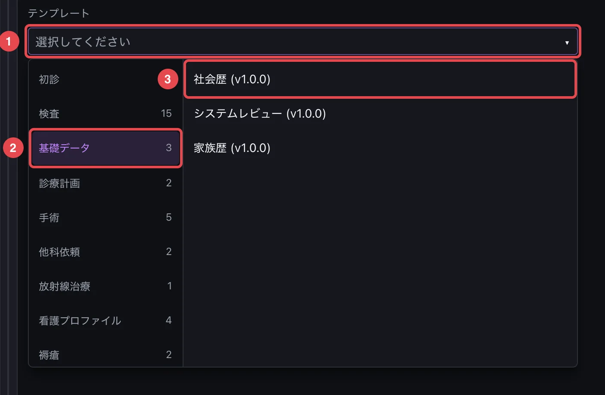
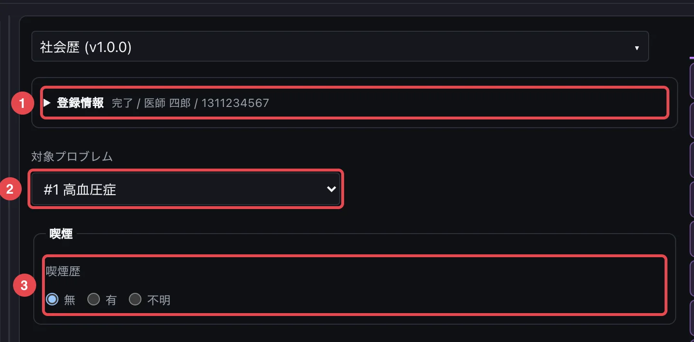
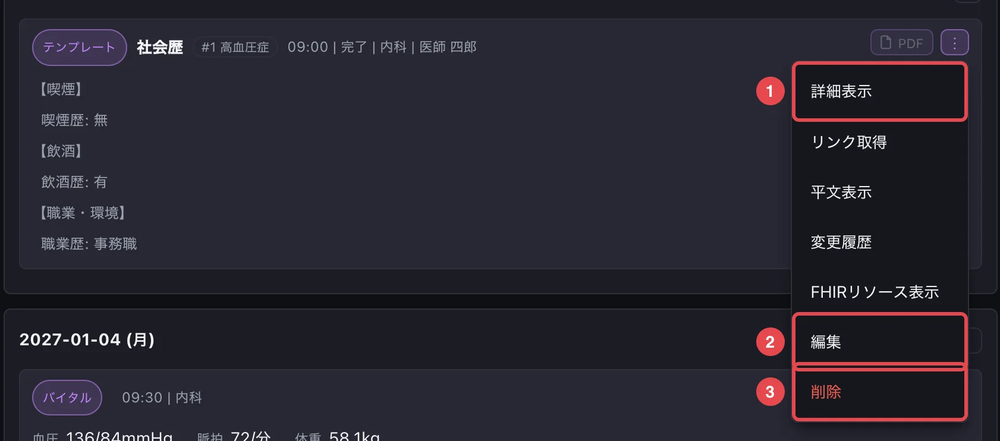
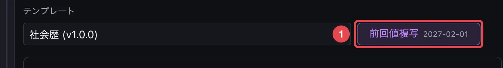

# テンプレート

決まった書式の入力画面(テンプレート)に記入して、カルテに登録する操作です。社会歴・家族歴のような基礎データや、
検査・手術の記録など、施設で用意したテンプレートを使います。

診療記録の本文の一部をテンプレートで書くときは、診療記録のセクションの「テンプレート」を使います(操作マニュアルの[診療記録](clinical-note.md#本文を書く))。

## テンプレートを選ぶ

患者のカルテを開き、右側の登録のボタンから「テンプレート」を押します。右側に「テンプレート登録」が開きます。

{ .screen width="704" }

1. 「テンプレート」の欄を押します。左に分類、右にその分類のテンプレートが並びます。
2. 分類を押します。分類の右の数は、その分類のテンプレートの数です。
3. 使うテンプレートを押します。テンプレートの入力画面が開きます。

## 記入して登録する

{ .screen width="719" }

1. 「登録情報」に、ステータス・記入者名・保険医療機関番号がまとめて出ます。初期値はステータスが「完了」、記入者名がログインしている人、保険医療機関番号が自院の番号です。書き終えていないときは、押して開き、ステータスを「入力中」にします。
2. 「対象プロブレム」で、この記入に関係するプロブレムを選びます。
3. 設問に答えます。答えによって、続きの設問が出るものがあります(「飲酒歴」で「有」を選ぶと「飲酒の詳細」が出る、など)。

記入したら、入力画面のいちばん下の「登録」を押します。必須の設問に答えていないと、登録できません。

登録すると右側が閉じ、カルテにテンプレートのカードが出ます。

## 登録した記入を見る・直す

カルテのテンプレートのカードの「⋮」から操作します。

{ .screen width="841" }

1. 「詳細表示」で、記入の内容を見られます。シェーマの描き込みのあるテンプレートは、ここで画像を見られます。
2. 「編集」を押すと、右側に記入が開きます。直して「更新」を押します。
3. 「削除」を押すと、理由を入れて記入を削除します。

- 「平文表示」で、記入の内容を文章の形で見られます。
- 「変更履歴」で、直すたびに残る版を見られます。
- 印刷用の書式(帳票)が用意されているテンプレートは、カードの「PDF」で帳票を開けます。書式の無いテンプレートでは押せません。

## 前回の記入を写す

同じ患者に同じテンプレートを前に記入していると、テンプレートの横に「前回値複写」が出ます。

{ .screen width="704" }

1. 「前回値複写」を押すと、前回の記入(ボタンの日付の記入)が入ります。変わったところだけを直して「登録」を押します。写したあとに押すと「複写取消」になり、空に戻せます。

- 前回の記入は書き換わらず、新しい記入として登録されます。
- シェーマの描き込みは写りません。
- テンプレートが改訂されて版が変わると、前の版の記入は写せません。
