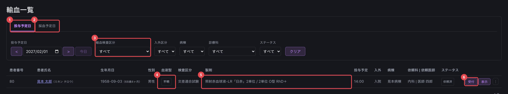
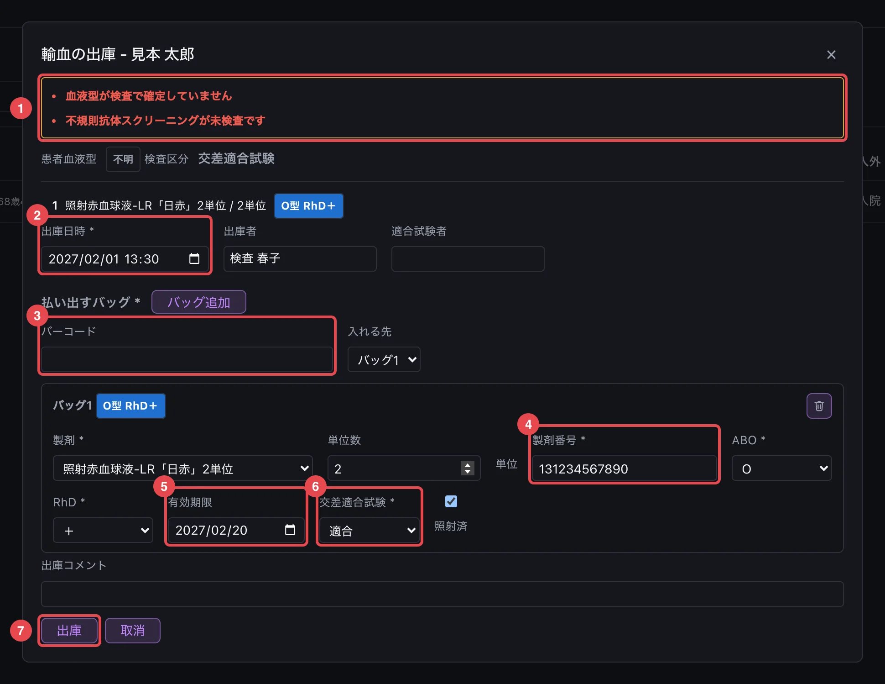
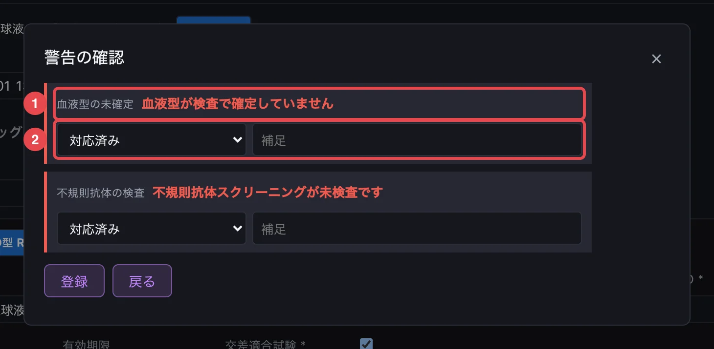
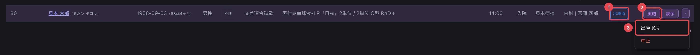
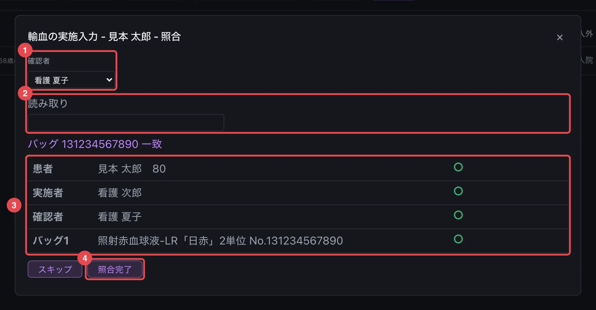
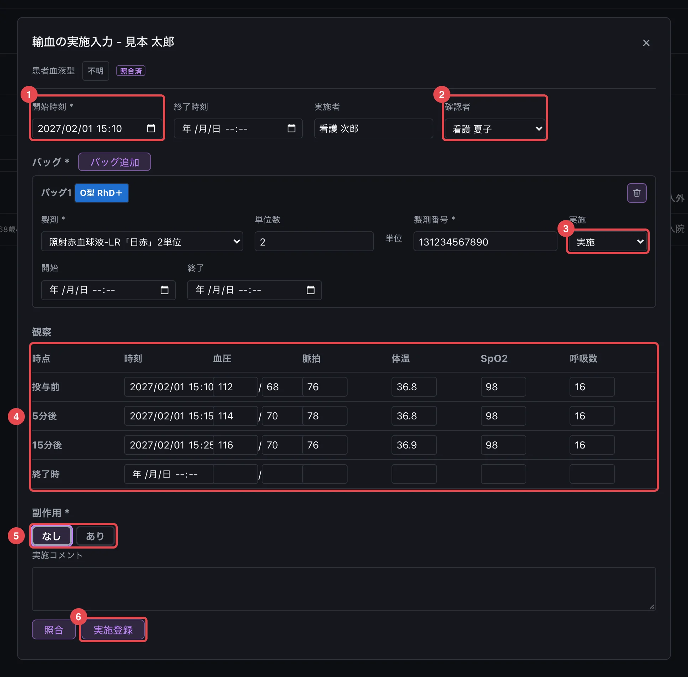
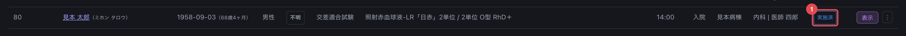

# 輸血一覧

輸血部門が、医師の輸血の依頼を輸血一覧で受け付けて製剤を出庫し、病棟の看護師が投与の実施を記録する操作です。
輸血の流れ全体は、業務フローの[輸血オーダー](../flows/transfusion.md)を見てください。依頼は[輸血](transfusion.md)のページです。

- 輸血一覧は、画面の上の「部門業務」>「輸血部門」>「輸血一覧」で開きます。ホームの「輸血」のカードからも開けます。
- 作業は「依頼済」→(受付)→「受付済」→(出庫)→「出庫済」→(実施)→「実施済」と進みます。
- 出庫と実施を分けて記録するので、出庫したまま投与されていない製剤を輸血部門で把握できます。
- 血液型検査・不規則抗体スクリーニング・交差適合試験の結果は、検体検査の結果として登録します。

## 輸血一覧の見方

{ .screen }

1. 「投与予定日」のタブに、その日に投与する依頼が並びます。
2. 自己血の採血の予定は「採血予定日」のタブに並びます。
3. 「輸血検査区分」「入外区分」「病棟」「診療科」「ステータス」で絞り込めます。
4. 「血液型」に、検査で確定した患者の血液型が出ます。確定していないときは「不明」です。
5. 「製剤」に、依頼した製剤・単位数と、製剤の型が出ます。
6. 依頼を受けたら「受付」を押します。受付済になると「出庫」が出ます。

「表示」で依頼の内容を開きます。行の「⋮」から、受付取消・中止などを行います。

## 出庫する

「出庫」を押すと、依頼した製剤のバッグの行が並んだ状態で出庫の画面が開きます。

{ .screen width="970" }

1. 確かめておくことが、画面の上に赤字で出ます。患者の血液型が確定していない、不規則抗体スクリーニングが未検査、有効期限や交差適合試験が未入力などです。
2. 「出庫日時」を確かめます。出庫者はログインしている人です。適合試験者を入れます。
3. 製剤ラベルのバーコードを「バーコード」で読むと、「入れる先」のバッグに製剤番号・製品・型・有効期限が入ります。
4. 読めないときは「製剤番号」を手で入れます。
5. 「有効期限」を確かめます。
6. 「交差適合試験」の結果(適合・不適合・省略)を選びます。照射した製剤は「照射済」にチェックを付けます。
7. 「出庫」を押します。

- バッグを足すときは「バッグ追加」を押します。
- 出庫するバッグの型が、患者の型に適合するか、依頼の型と同じかを確かめます。適合しないバッグも出庫は止めませんが、確認の画面で理由を残します。

確かめることが残っているときは、確認の画面が出ます。

{ .screen width="730" }

1. 警告の内容が出ます。
2. 警告ごとに理由を選び、必要なら補足を書いて「登録」を押します。選んだ理由は記録に残ります。

{ .screen }

1. ステータスが「出庫済」になります。
2. 投与するときに「実施」を押します。カルテの輸血のカードの「実施入力」からも開けます。
3. 出庫を取り消すときは「⋮」の「出庫取消」を押します。出庫の記録ごと消えます。

## 投与の実施を記録する

「実施」を押すと、先に患者とバッグを照合する画面が開きます。

{ .screen width="970" }

1. 「確認者」を選びます。2 人で照合します。
2. 「読み取り」で、患者のリストバンドと製剤ラベルのバーコードを読みます。
3. 患者・実施者・確認者・バッグが一致すると「○」になります。患者やバッグが違うと、その旨が出ます。
4. 全部が一致したら「照合完了」を押します。

読めないときは、理由を選んで「スキップ」を押します。

{ .screen width="970" }

1. 「開始時刻」を確かめます。終わったら「終了時刻」を入れます。
2. 照合で選んだ「確認者」が入っています。実施者はログインしている人です。
3. バッグごとに「実施」「未実施」「返却」を選びます。投与しなかったバッグは消さずに「未実施」か「返却」で残します。
4. 「観察」に、投与前・5 分後・15 分後・終了時の血圧・脈拍・体温・SpO2・呼吸数を入れます。経過表にも載ります。
5. 「副作用」の「なし」か「あり」を選びます。「あり」は症状を選ぶか内容を書きます。副作用が無かったことも記録に残します。
6. 「実施登録」を押します。

{ .screen }

1. ステータスが「実施済」になります。

- 輸血後 24 時間以降に出た副作用は、カルテの輸血のカードの「副作用追記」で足します。
- 実施の記録を直すときは、「実施取消」で記録ごと消してから、もう一度実施入力をします。
