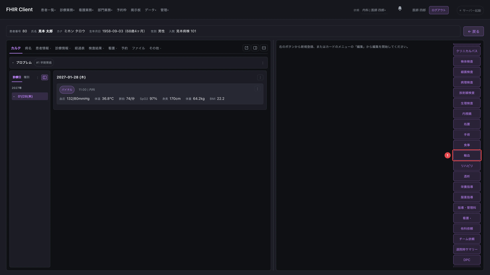
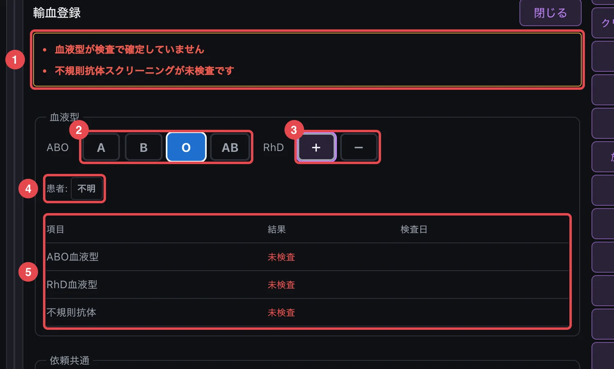
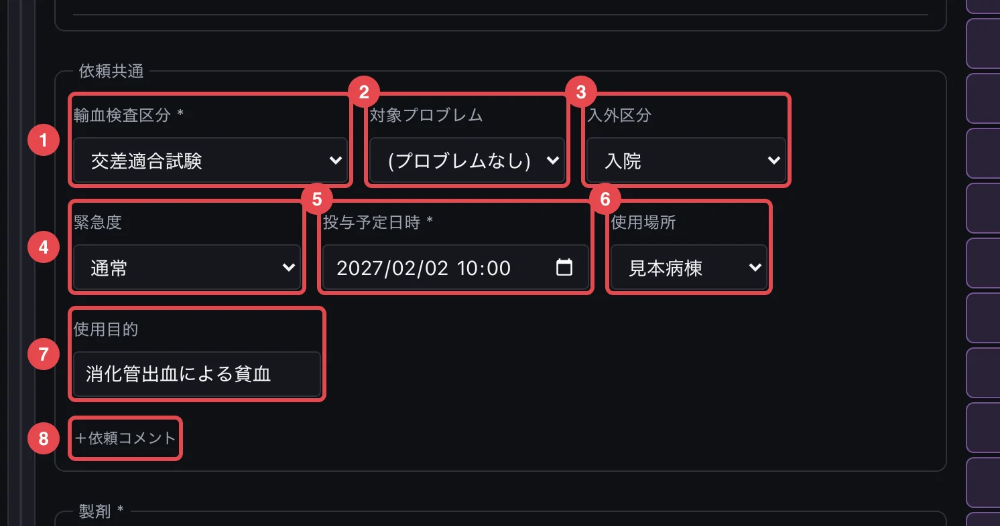
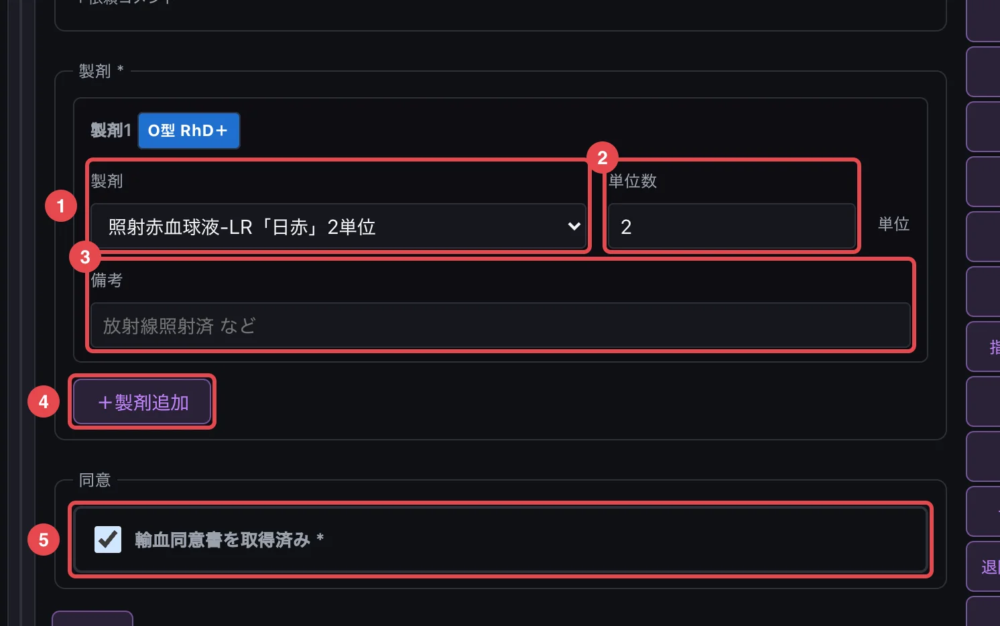
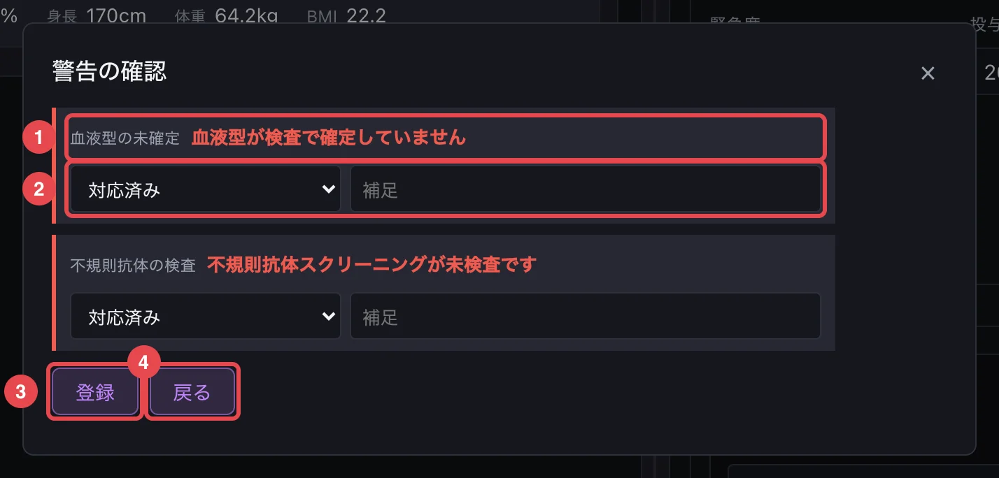
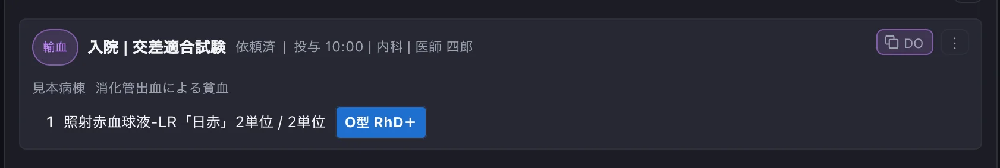
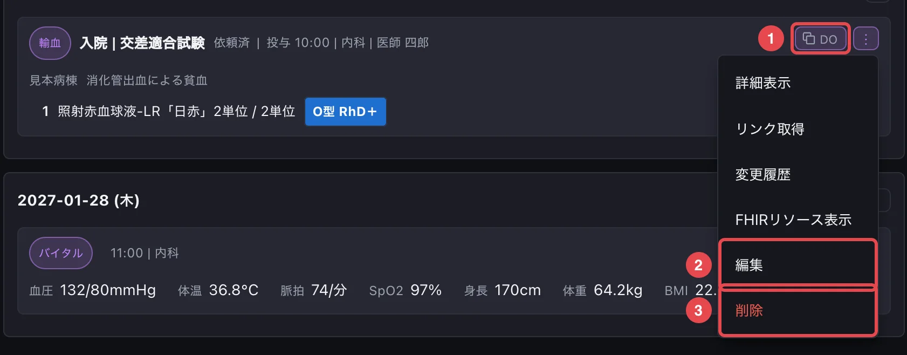

# 輸血

医師がカルテから輸血(血液製剤)を依頼する操作です。輸血部門の受付・出庫、病棟での実施、自己血の採血までの流れは、
業務フローの[輸血オーダー](../flows/transfusion.md)を見てください。

このページで使う呼び名です。

- **患者の型**: 検体検査の血液型の結果から決まる型です。異なる日の 2 回の検査で一致すると確定します。医師は患者の型を手で入れません。
- **製剤の型**: 依頼する製剤の型です。患者の型に合う型だけを選べます。

## 輸血登録を開く

患者のカルテを開いておきます。

{ .screen }

1. カルテの右側に並ぶボタンから「輸血」を押します。右側に「輸血登録」が開きます。

## 血液型を確かめる・製剤の型を選ぶ

{ .screen width="750" }

1. 血液型が確定していない、不規則抗体の検査が無いなど、気を付けることが上に出ます。
2. 「ABO」で製剤の型を選びます。選んだ型は日赤の製剤ラベルと同じ色になります。患者の型に合わない型は押せません。
3. 「RhD」で製剤の Rh 型を選びます。
4. 「患者」に、検査で確定した患者の型が出ます。確定していないときは「不明」です。
5. ABO 血液型・RhD 血液型・不規則抗体の検査の結果と検査日が出ます。

患者の型が不明のときは、赤血球製剤は O 型、血漿・血小板製剤は AB 型だけを選べます。
患者の型と違う型を選ぶと、製剤に「異型」の印が付きます。

## 依頼共通を入れる

項目名に「*」が付いたものは必ず入れます。

{ .screen width="746" }

1. 「輸血検査区分」を選びます。

    | 輸血検査区分 | 内容 |
    |---|---|
    | 交差適合試験 | 製剤を指定して、患者の血液と混ぜて確かめる |
    | T&S(タイプ&スクリーン) | 血液型と不規則抗体だけを先に調べておく |
    | コンピュータクロスマッチ | 型が 2 回の検査で確定し、不規則抗体が陰性なら試験管の試験を省く |
    | 生食法 | 危機的出血のレベルⅡで使う |
    | 交差試験なし | 危機的出血のレベルⅠで使う |

2. 「対象プロブレム」で、この輸血の対象の病名を選びます。
3. 「入外区分」で「入院」か「外来」を選びます。
4. 「緊急度」を選びます。危機的出血のときは、準備の目安の時間が付いたレベルⅠ〜Ⅲから選びます。
5. 「投与予定日時」を入れます。
6. 「使用場所」で、輸血する病棟・手術室などを選びます。
7. 「使用目的」を入れます。
8. 輸血部門へ伝えることがあれば「＋依頼コメント」を押して入れます。

## 製剤を選ぶ・同意を確かめる

{ .screen width="746" }

1. 「製剤」で、依頼する製剤を選びます。見出しに製剤の型が出ます。
2. 「単位数」を入れます。
3. 必要なら「備考」を入れます。
4. ほかの製剤も依頼するときは「＋製剤追加」を押し、同じように入れます。
5. 輸血同意書を取得したら、「輸血同意書を取得済み」にチェックを付けます。チェックが無いと登録できません。

自己血(貯血式)を選ぶと、採血の予定を入れる欄が出ます。採血の予定は、投与予定日時より前にします。

## 登録する

「登録」を押します。確かめが要る警告があると、「警告の確認」が出ます。

{ .screen width="714" }

1. 警告の種類と内容が出ます。
2. 警告ごとに理由を選びます。必要なら横の「補足」に書き添えます。
3. 「登録」を押すと、理由を残して登録します。
4. 入力を直すときは「戻る」を押します。

| 確かめが要る警告 | 出るとき |
|---|---|
| 血液型の未確定 | 血液型が 2 回の検査で確定していない |
| 不規則抗体の検査 | 不規則抗体スクリーニングが未検査か、有効期間を過ぎている |
| 輸血拒否 | 輸血拒否の注意が登録されている |
| 自己血の期限 | 自己血の 1 回目の採血が、手術日までに期限切れになる |

異型の製剤・輸血の副作用歴・移植後の型は、フォームに出るだけで、確認は要りません。

登録すると右側が閉じ、カルテの投与予定日のところに輸血のカードが出ます。

{ .screen width="841" }

## 登録した輸血を使う・直す

カルテの輸血のカードから操作します。

{ .screen width="841" }

1. 「DO」を押すと、同じ内容が右側の「輸血登録」に入ります。
2. 「⋮」の「編集」を押すと、右側に編集が開きます。直して「更新」を押します。出庫・実施のあとでも直せますが、採血済みの予定は動かせません。
3. 「⋮」の「削除」を押すと、理由を入れて輸血を削除します。

- 出庫・採血・実施のどれかの記録がある輸血は削除できません。
- 輸血をやめるときの「中止」は、カルテのカードではなく、輸血部門の輸血一覧の行のメニューで行います。
- 編集しても、輸血部門へ通知は届きません。
