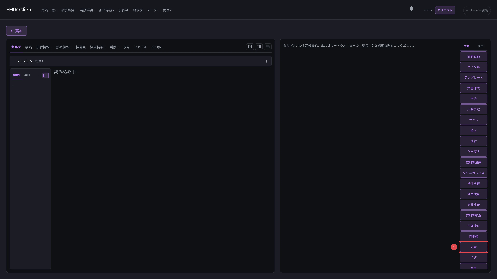
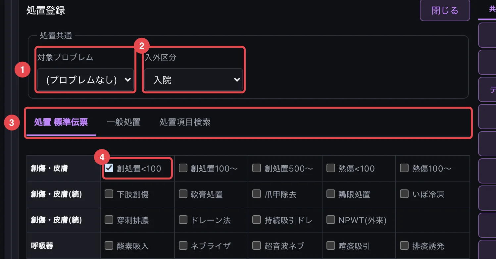
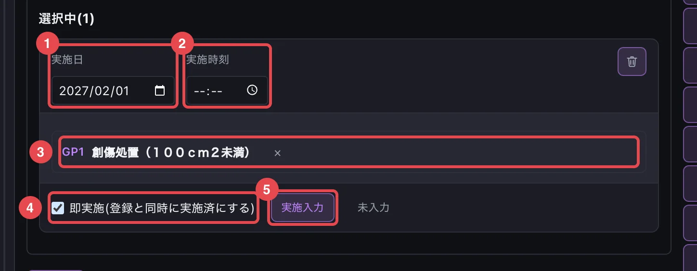
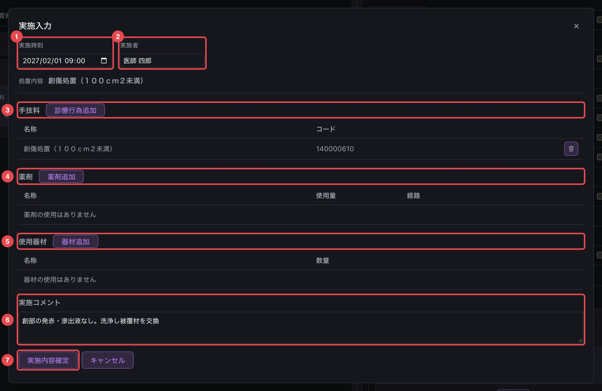
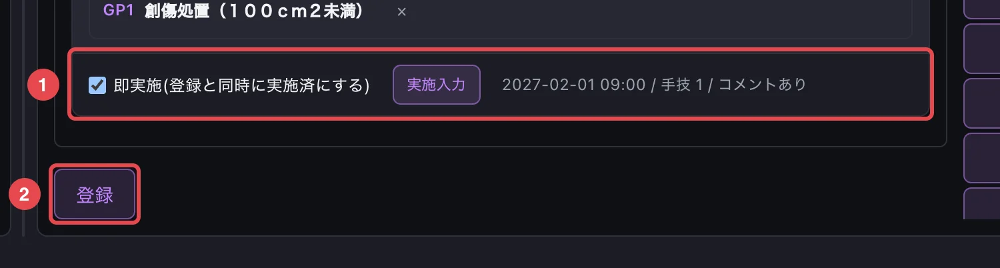
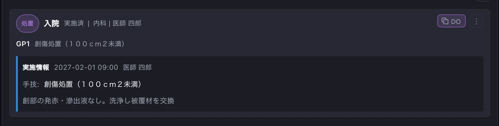
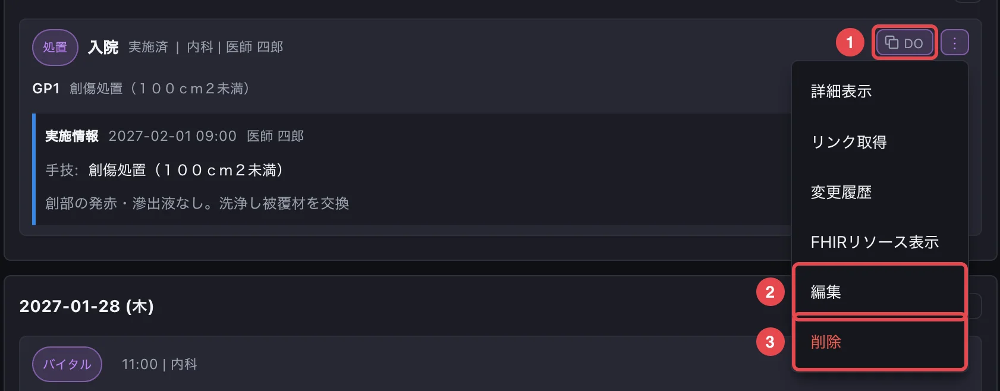

# 処置

医師がカルテから処置を選んで登録する操作です。病棟や診察室でその場で行った処置は、「即実施」で実施の記録まで一緒に登録します。
処置室での受付・実施の流れは、業務フローの[生理検査・内視鏡・処置オーダー](../flows/physio-endoscopy-treatment.md)を見てください。

処置には、至急区分・日付未定・依頼病名・検査目的はありません。実施日は必ず入れます。

## 処置登録を開く

患者のカルテを開いておきます。

{ .screen }

1. カルテの右側に並ぶボタンから「処置」を押します。右側に「処置登録」が開きます。

## 処置項目を選ぶ

{ .screen width="749" }

1. 「対象プロブレム」で、この処置の対象の病名を選びます。
2. 「入外区分」で「入院」か「外来」を選びます。
3. 伝票のタブを切り替えます。伝票に無い項目は「処置項目検索」で名前から探します。
4. 行う処置にチェックを付けます。

伝票の「セット」の行には、よく一緒に行う処置のまとまりが並びます。

## 実施日を入れる・即実施にする

{ .screen width="724" }

1. 「実施日」を入れます。初期値は今日です。
2. 時刻を決めるときは「実施時刻」に入れます。
3. 処置項目が出ます。「×」を押すと、その項目を外します。
4. その場で行った処置を登録するときは、「即実施」にチェックを付けます。登録と同時に実施済になります。
5. 「実施入力」を押して、実施の内容を入れます(下の「実施の内容を入れる」)。入れるまでは横に「未入力」と出ます。

予約必須の処置は、実施日の代わりに「予約」が出ます。予約の操作は[生理検査](physio.md#予約する)と同じです。予約する処置は「即実施」にできません。

## 実施の内容を入れる

{ .screen width="1194" }

1. 「実施時刻」を確かめます。初期値はいまの日時です。
2. 「実施者」を確かめます。初期値はログインしている人です。
3. 「手技料」に、選んだ処置の診療行為が入っています。ほかの手技を足すときは「診療行為追加」を押します。行のゴミ箱で外せます。
4. 使った薬剤があれば「薬剤追加」を押して選び、使用量を入れます。
5. 使った器材があれば「器材追加」を押して選び、数量を入れます。
6. 必要なら「実施コメント」を入れます。
7. 「実施内容確定」を押します。

## 登録する

{ .screen width="750" }

1. 「即実施」の横に、入れた実施の内容の要約が出ます。直すときは「実施入力」をもう一度押します。
2. 「登録」を押します。

登録すると右側が閉じ、カルテに処置のカードが出ます。即実施で登録した処置は「実施済」になり、実施の情報が出ます。

{ .screen width="841" }

即実施にしなかった処置は、処置室の処置一覧に並び、処置室で実施を記録します。

## 登録した処置を使う・直す

カルテの処置のカードから操作します。

{ .screen width="841" }

1. 「DO」を押すと、同じ処置項目が右側の「処置登録」に入ります。実施の記録は写りません。
2. 「⋮」の「編集」を押すと、右側に編集が開きます。直して「更新」を押します。
3. 「⋮」の「削除」を押すと、理由を入れて処置を削除します。

- 実施を記録した処置は削除できません。先に、処置一覧の行のメニューの「取消」で実施の記録を取り消します。
- 処置をやめるときの「中止」は、カルテのカードではなく、処置一覧の行のメニューで行います。
