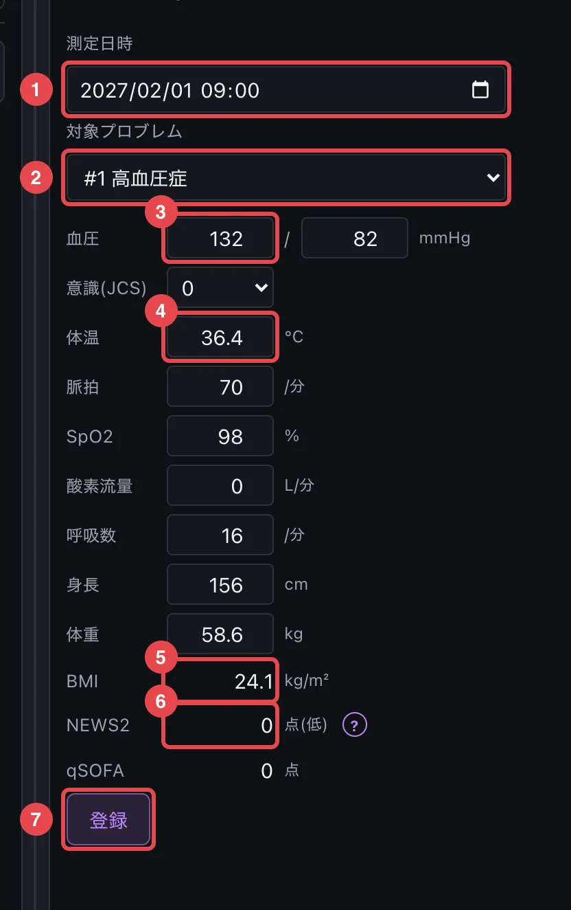
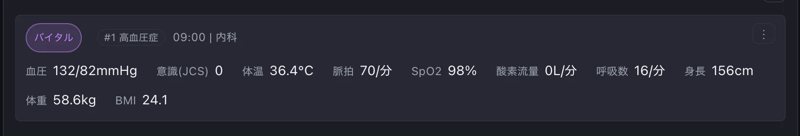
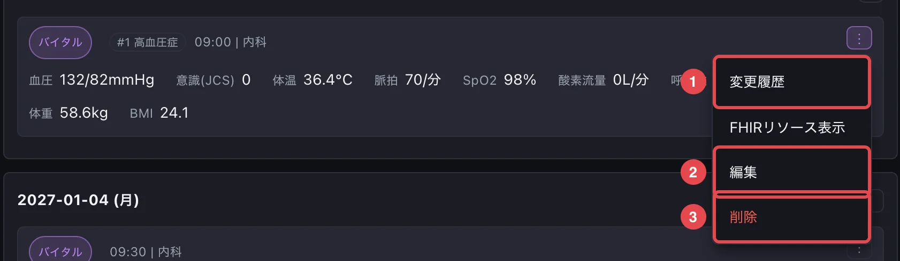

# バイタル

カルテに体温・血圧・脈拍などの測定値を入れて登録する操作です。1 回の測定をまとめて 1 枚のカードにします。

入院中の患者の測定を病棟でまとめて入れるときや、1 週間の推移を見るときは「経過表」タブを使います。

## バイタル登録を開く

患者のカルテを開き、右側の登録のボタンから「バイタル」を押します。右側に「バイタル登録」が開きます。

## 測定値を入れて登録する

{ .screen width="416" }

1. 「測定日時」を確かめます。初期値はいまの日時です。
2. 「対象プロブレム」で、この測定に関係するプロブレムを選びます。選ばないときは「(プロブレムなし)」のままにします。
3. 「血圧」は、左に収縮期(上)、右に拡張期(下)を入れます。片方だけでは登録できません。
4. ほかの項目も、測った値を入れます。測っていない項目は空欄のままにします。

    | 項目 | 単位 | 入れ方 |
    |---|---|---|
    | 意識(JCS) | | 選択肢から選びます |
    | 体温 | ℃ | |
    | 脈拍 | /分 | |
    | SpO2 | % | |
    | 酸素流量 | L/分 | 酸素を使っていない(室内気)ときは 0 を入れます |
    | 呼吸数 | /分 | |
    | 身長 | cm | |
    | 体重 | kg | |

5. 身長と体重を入れると、「BMI」が計算されて一緒に記録されます。
6. 早期警告スコアを使う施設では、入れた値から「NEWS2」と「qSOFA」の点数が出ます。「?」で計算式を見られます。入院中の患者で点数が高いと、登録したときに主治医に通知が届きます。
7. 「登録」を押します。

登録すると右側が閉じ、カルテにバイタルのカードが出ます。

{ .screen width="841" }

## 登録したバイタルを直す

カルテのバイタルのカードの「⋮」から操作します。

{ .screen width="841" }

1. 「変更履歴」で、直すたびに残る版を見られます。
2. 「編集」を押すと、右側に「バイタル編集」が開きます。直して「更新」を押します。値を消した項目は、記録からも消えます。
3. 「削除」を押すと、理由を入れて 1 回の測定をまとめて削除します。理由は「誤入力」「患者間違い」「重複登録」から選ぶか、文字で入れます。
